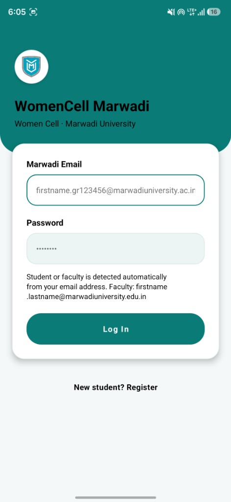
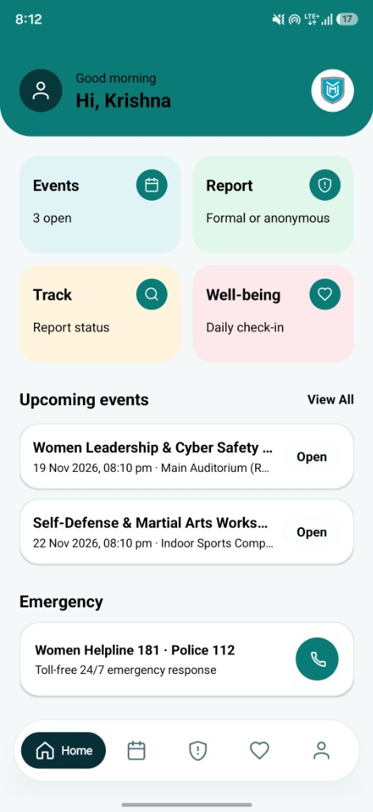
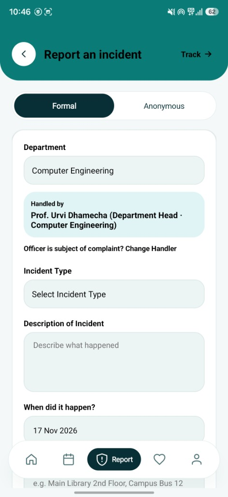
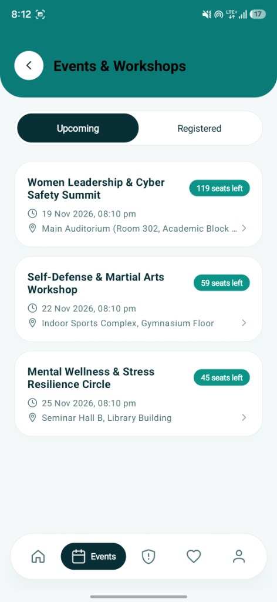
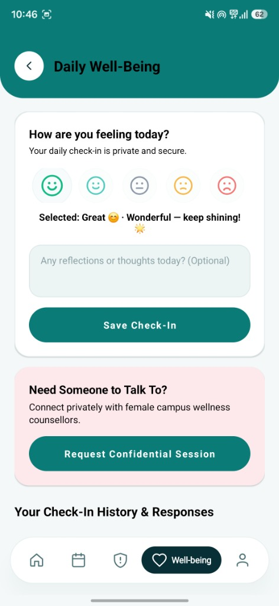

# womenCell

A confidential and secure campus safety, grievance redressal, and student well-being Android application.

## About
**womenCell (SafeSpace)** is an Android application developed for the Women's Cell & Internal Complaints Committee of Marwadi University. It provides female students and faculty members with a safe, confidential platform to report grievances (either anonymously or identified), track case resolutions in real-time, schedule counseling appointments, monitor daily mental well-being check-ins, and quickly access campus and national emergency helplines.

## Features
- Role-based Authentication (dedicated portals for students and faculty)
- Zero-Knowledge Anonymous Grievance Filing with secure tracking codes (`WC-XXXXXX`)
- Real-time Grievance Tracking & Status Updates (Submitted, Under Review, Action Taken, Resolved)
- Emergency SOS Quick-Dialer (1-tap direct dial for Campus Security, National 181, 112, NCW)
- Daily Mental Well-being & Mood Tracker (mood, stress level, and sleep quality)
- Confidential Counseling & Mentorship Appointment Booking
- Faculty & Committee Administration Panel to manage cases and communicate resolutions

## Screenshots






## Tech Stack
- Language: Kotlin
- IDE: Android Studio
- Min SDK: 26 (Android 8.0) | Target SDK: 34 (Android 14)
- Backend/Database: SQLite with Room & SQLCipher (256-bit AES encryption)

## Getting Started
1. Clone the repository:
   ```bash
   git clone https://github.com/Krishnaavv/MU_WomenCell.git
   ```
2. Open the project in Android Studio.
3. Let Gradle sync finish.
4. Run the app on an emulator or a physical device (API 26+).

## Author
krishna v - [GitHub profile](https://github.com/Krishnaavv)
